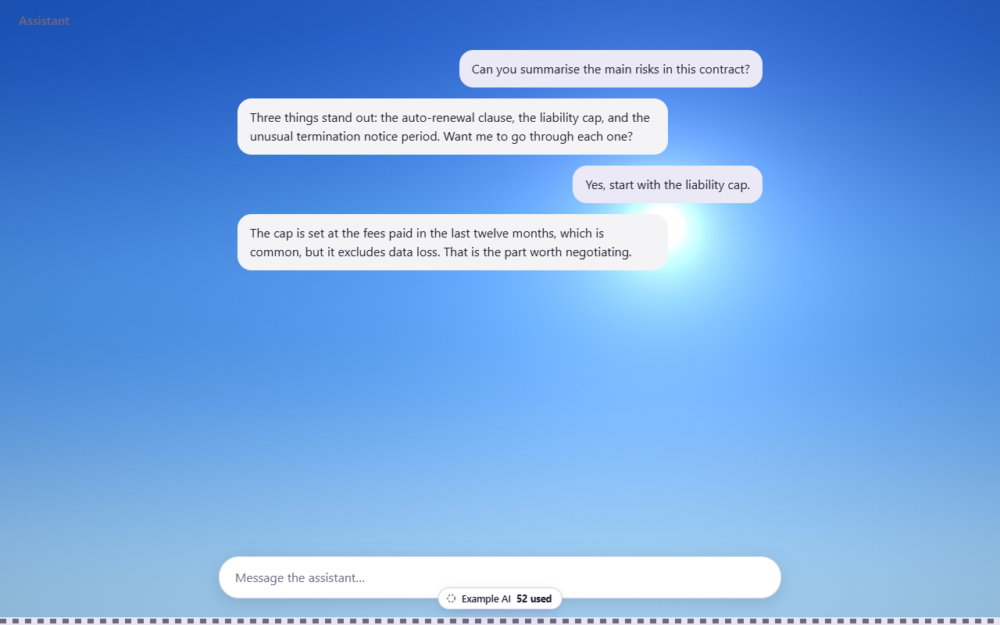
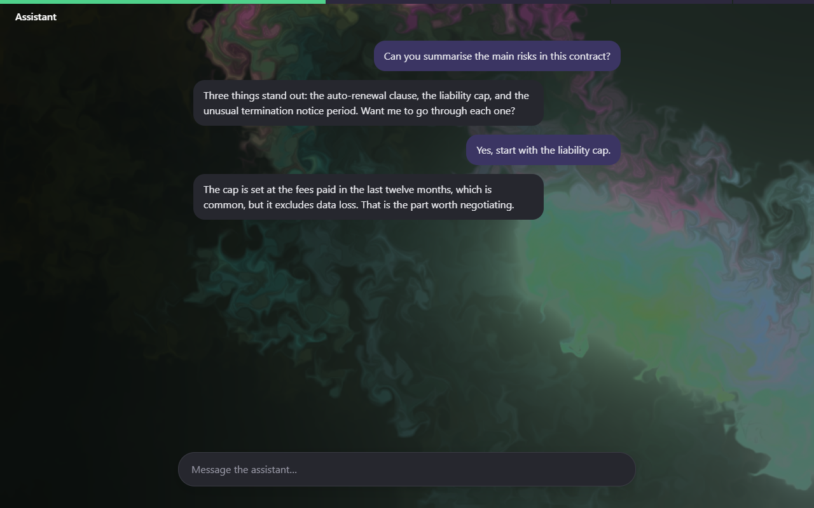
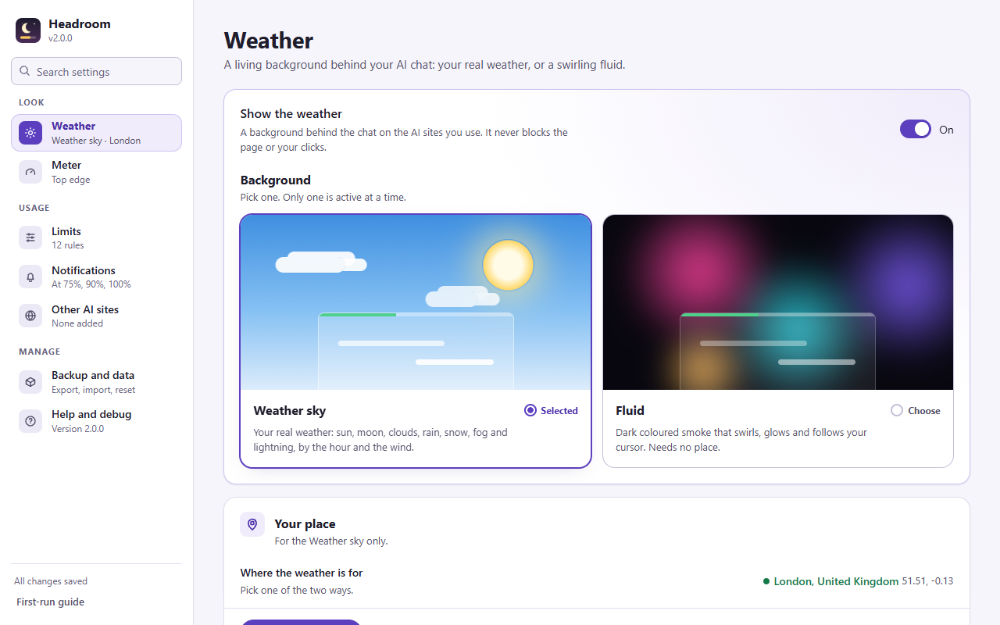
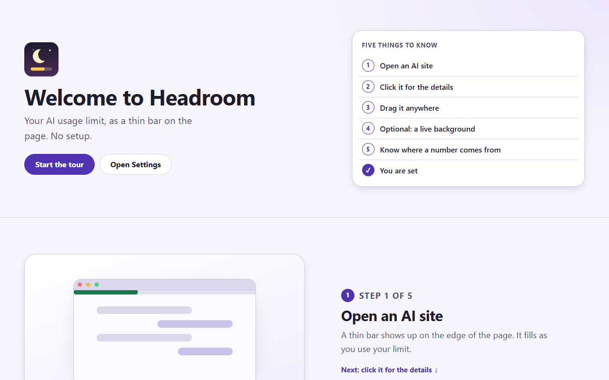

<p align="center"></p>

# Headroom

**Your AI usage limit, as a thin bar on the page, under a living background.**

<p align="center"><a href="https://chromewebstore.google.com/detail/headroom/omnaoikjfiodkffgjdkkepcgocnpdjcb"></a></p>

<p align="center">Version 2.0 · MIT · no account, no server, nothing leaves your computer except an optional weather lookup</p>

[**Install from the Chrome Web Store**](https://chromewebstore.google.com/detail/headroom/omnaoikjfiodkffgjdkkepcgocnpdjcb) · [What's new in 2.0](CHANGELOG.md) · [Privacy](docs/privacy.md)

<p align="center">
  
  
</p>
<p align="center">
  
  
</p>

*Formerly AI Meter. Old exported settings files still import and load.*

A Chrome extension with two jobs on the AI sites you use. It shows how much of your usage limit is left on **Claude, ChatGPT, Gemini, Grok, Perplexity, Kimi, DeepSeek, Qwen, Le Chat, Copilot, Meta AI, Poe and any other AI chat site you add**, as a thin bar along the edge of the page and a toolbar badge. And it can put a **living background behind your chat**: the **real weather** (the sun, moon and stars at the real hour, clouds moving with the real wind, rain, snow, fog, lightning, falling leaves in autumn), or a dark **fluid** that swirls and glows and follows your cursor. You choose in Settings → Weather → Background.

## What's new in 2.0

- **Redesigned Settings and Welcome:** a sidebar with live summaries, cards that use wide screens, a preview picker for the background, and a picture-led first-run guide. Responsive from phone widths to ultrawide, light and dark.
- **A second background, Fluid:** black until you move the cursor, then coloured smoke follows it and fades. Needs no place and no forecast.
- **A clean message box:** no pale plates, frames or strips left around it on any page colour, and text on the background switches between near-black and white by itself so it stays readable.
- **Sturdier:** batched work for pages with thousands of elements, Windows high-contrast support, a Settings page that never shows a stale section, and a much larger automated test suite (unit tests, browser scenarios, pixel tests and an accessibility scan). The full list is in [CHANGELOG.md](CHANGELOG.md).

## Install

**From the Chrome Web Store (recommended):** [Add Headroom to Chrome](https://chromewebstore.google.com/detail/headroom/omnaoikjfiodkffgjdkkepcgocnpdjcb). A short, picture-led guide opens on first install. Open any supported AI site and the bar appears along the top of the page.

**From source (unpacked), for development:**

1. Clone or download this repo.
2. Open `chrome://extensions`, turn on **Developer mode**.
3. Click **Load unpacked** and pick the repo folder (the one with `manifest.json`).
4. A short "how it works" page opens on first install. Open any supported site: a thin bar appears along the top of the page (point at it for the percentage, click or press Enter for details; drag it to the bottom, left or right edge if you prefer, and use the gear in the details panel to open Settings). Open **Settings → Weather** to choose your place and switch the sky on.

Settings is one page at a time with a left nav and search, and everything saves as you change it. It also has **Export / Import settings** (a backup file with your limits, thresholds and meter and weather options, never usage data or your place) and a link to the first-run guide.

## How each provider is measured

Every meter is tagged with where its number came from:

| Tag | Meaning |
|---|---|
| `real` | Read from the provider's own usage data |
| `estimate` | Counted locally from your sends, compared against limits you set |
| `banner` | Picked up from the site's own "limit reached" / "N messages left" notice |

| Provider | Source | How | Verified live |
|---|---|---|---|
| Claude | `real` | `GET /api/organizations/{org}/usage` — the endpoint behind Settings › Usage. Session (5h) + weekly utilization and reset times. | yes |
| ChatGPT | `estimate` + `real` | Chat caps aren't exposed anywhere, so sends are counted per model (defaults: 160 / 3h, Thinking 3000 / week). Real Codex 5h / weekly windows from `GET /backend-api/wham/usage` (Bearer from `/api/auth/session`, kept in memory only), plus `limits_progress` feature counters. | no |
| Gemini | `real` | Replays the `jSf9Qc` batchexecute RPC behind gemini.google.com/usage → 5h + weekly usage. Falls back to counting prompts. | yes (2026-10-17) |
| Grok | `real` | Per-model chat limits from `POST /rest/rate-limits` (`remainingQueries` / `totalQueries` over a 24h window on the free tier; counts down as you chat). The gRPC-web `GrokBuildBilling/GetGrokCreditsConfig` weekly pool is the separate Grok Build credit pool and is shown only if it reports usage. Sends detected on the `/ws/mgw` WebSocket. | yes (2026-10-17) |
| Perplexity | `real` | `GET /rest/rate-limit/all` → remaining Pro searches / research / labs. | no |
| Kimi | `real` | `MembershipService/GetSubscription` → `balances[].amountUsedRatio`. | no |
| DeepSeek, Qwen, Le Chat, Copilot (copilot.com, formerly copilot.microsoft.com), Meta AI, Poe | `estimate` | None of these expose usage; sends are counted (Le Chat default 25 / day). | no |
| Any site you add | `estimate` | Settings → Other AI sites. Sends detected heuristically (chat-like POST or WebSocket text frame). | — |

Every site also gets two free signals: the site's own limit notices (banner watcher) and HTTP 429 responses (with `Retry-After` as the reset time).

Estimate limits change often and differ by plan — set yours in **Settings → Estimate rules**.

## Weather

Settings → **Weather**. Choose where you are with **Use my location** (Chrome asks once) or by typing a city. From then on every AI site you use gets a sky behind the chat that follows the real weather.

- **What it shows.** Clear, partly cloudy, overcast, drizzle, rain, thunderstorm, snow and fog, with the sun and moon at the real hour (from the real sunrise and sunset), clouds that move the way the real wind blows, and falling leaves (autumn) or petals (spring). India gets a monsoon, not four temperate seasons.
- **Two backgrounds (2.0).** Settings → Weather → **Background** picks the real-weather sky or a dark **fluid** that swirls and follows your cursor (it needs no place and no forecast, and only moves when you move the mouse). Both sit behind the page, never block clicks, pause in hidden tabs and honour reduced motion; text on top turns white or near-black on its own. The fluid is a trimmed port of Pavel Dobryakov's MIT-licensed WebGL Fluid Simulation (see `THIRD_PARTY_NOTICES.md`); a standalone demo is `tools/fluid-demo/index.html`.
- **How it is drawn.** One WebGL fragment shader in `src/core/weather-sky.js`, no images, no downloads. It sits behind the page (the page's big opaque backgrounds are made transparent while it is on), so text and images keep their own colours by day. The text on top turns near-black or white by itself, whichever is easier to read on the sky of the moment, and anything with its own paint (cards, code blocks, inputs) keeps its own colours; **Sky strength** in Settings turns the background up or down. It never blocks the page or your clicks (`pointer-events: none`), draws at most 30 frames a second, at the screen's pixel density (capped) and steps its resolution down by itself on a slow graphics card, pauses when the tab is hidden, stays still if your system asks for reduced motion, and its code is injected into a tab only when the weather is on.
- **Where the data comes from.** The background script asks [Open-Meteo](https://open-meteo.com) (free, no key, no account) for the forecast every 20 minutes and keeps it in `chrome.storage.local`; tabs only read it. Only the place's **coordinates rounded to two decimals** (about 1 km) are sent, to `api.open-meteo.com`. The place is stored on your computer and is never part of a settings backup.
- **One click off.** The details panel on the page has **Turn off weather** and a settings gear that opens Settings. Settings → Weather → **Try a look** shows any weather, season or hour for testing.
- Preview with controls: `node tools/weather-preview/serve.mjs` and open http://localhost:8802. This dev page still shows the pre-1.4 sky; the current design reference is `docs/sky-redesign/live-sky.html`.

## Adding any AI site

Settings → **Other AI sites** → enter the hostname (e.g. `chat.example.com`), optional limit + window → **Add site**. Chrome asks for access to that one site only (`optional_host_permissions`); Headroom then registers its scripts there with `chrome.scripting.registerContentScripts`. Remove the site to revoke access.

## Privacy

The full policy is in [`docs/privacy.md`](docs/privacy.md). The short version:


- Everything stays in `chrome.storage.local` on your machine. No servers, no analytics.
- Sign-in, password, OAuth, MFA, checkout and payment requests are never read by the page hook, and secret-looking fields are masked in any body it does forward; the debug log masks emails, tokens and ids. Security review: [`docs/security-review-2026-10-31.md`](docs/security-review-2026-10-31.md).
- A page-world script mirrors network calls to the extension so it can spot sends and usage responses. Adapters only extract the **model name**; prompt text is never stored.
- The page-world script talks to the extension over a private `MessageChannel` (not `window.postMessage`, which every script on the page can read and forge), and every message is schema-validated. The bodies of sign-in, session, token, account and profile requests and responses are never forwarded. Tokens needed for a usage call (ChatGPT, Kimi) stay in memory and are sent only back to that provider's own domain.
- The debug log stores request bodies as key names only, full response bodies only for usage/limit endpoints, and just the JSON *shape* (keys and types) of anything else.
- The weather sky is injected into a tab only when the weather is on. Its only network call is the background script asking Open-Meteo for the forecast, with the rounded coordinates of the place you chose.
- Usage requests are made from your own logged-in tab, to the provider's own domain, exactly as the site's settings page would.

## Not affiliated

Headroom is an independent project. It is not affiliated with, endorsed by or sponsored by Anthropic, OpenAI, Google, xAI, Perplexity, Moonshot AI, DeepSeek, Alibaba, Mistral AI, Microsoft, Meta or Quora. Claude, ChatGPT, Gemini, Grok, Perplexity, Kimi, DeepSeek, Qwen, Le Chat, Copilot, Meta AI and Poe, and all related names and logos, are trademarks of their respective owners. They are used here only to identify the services Headroom works with.

## Store listing

Headroom is on the Chrome Web Store: **[chromewebstore.google.com/detail/headroom](https://chromewebstore.google.com/detail/headroom/omnaoikjfiodkffgjdkkepcgocnpdjcb)**. The store copy, permission justifications and screenshot list are in [`docs/store/listing.md`](docs/store/listing.md). What only the publisher can do to submit it: [`docs/store/submit-checklist.md`](docs/store/submit-checklist.md).

## Debugging endpoints

Providers change internal APIs without notice. If a meter stops updating:

1. Settings → Debug → enable logging, then reload the site's tab.
2. Use the site normally (send a message, open its usage/settings page).
3. Back in Settings, **Copy log**. It shows whether the network hook is active, every POST / WebSocket send (body keys only), full usage/limit responses, the shape of other JSON responses, and adapter errors.
4. Update the matching file in `src/adapters/` (parsers live in `src/core/parsers.js` with tests in `test/`).

## Credits

Endpoint shapes for ChatGPT `wham/usage`, Gemini `jSf9Qc`, Grok credits protobuf and Kimi were learned from the MIT-licensed [RateBucket](https://github.com/Chihiro521/RateBucket-rate-limit-bucket), [claudetuner](https://github.com/chaehyun2/claudetuner) and [CodexBar](https://github.com/steipete/CodexBar). Parsers here are independent JS implementations.

## Project layout

```
manifest.json
src/
  inject.js            page-world fetch/XHR hook → postMessage
  content.js           picks the adapter for this site, wires events, publishes meters
  background.js        badge, threshold + reset notifications, the 20-minute weather fetch
  core/
    quotas.js          providers, default estimate rules, settings merge
    common.js          pure helpers: limit parsing, rolling counts, reset-time parsing
    parsers.js         pure provider parsers (ChatGPT, Gemini, Grok protobuf, Kimi)
    store.js           chrome.storage helpers, local send counter
    banner.js          watches for the site's own limit notices
    widget.js          on-page meter bar (shadow DOM)
    weather-data.js    weather codes, seasons, sun times, the look of the sky (pure functions)
    sky-palette.js     hour x season x weather to sky colours and amounts (pure functions)
    weather-sky.js     the weather sky renderer (WebGL), injected on demand; also clears the page backdrops and picks the text colour
    fluid-sim.js       the optional "Fluid" background (WebGL fluid simulation that follows the cursor), injected on demand
  adapters/            one file per provider; generic.js = counting sites + user-added sites
  options/  welcome/          settings page, first-run guide
  (no images: the weather sky is drawn by one shader)
scripts/build-store-zip.mjs   builds the Web Store zip into release/<date>/ (npm run store-zip)
tools/                        preview pages for the weather, and the site smoke test
test/                         node:test suites (settings, background worker and weather fetch, weather data, widget, content, hooks, parsers)
docs/                         privacy policy, store listing and checklist, security and accessibility reviews
```

## Development

```bash
npm test            # node --test, no dependencies to install
(cd e2e && npm ci && node run-all.mjs)   # end-to-end: the unpacked extension in real Chromium against a mocked claude.ai (needs Playwright's Chromium)
(cd e2e && node pages.mjs .. )          # Settings and Welcome at 6 widths in light and dark: errors, overflow, axe accessibility scan, functional checks
npm run store-zip   # release/<date>/headroom-<version>.zip, the file you upload to the Web Store
```

Bump `manifest.json`, `package.json` and `CHANGELOG.md` together. One dated release folder, one zip.

## Adding a provider

Create `src/adapters/<name>.js`:

```js
Headroom.register({
  id: 'example', name: 'Example', hosts: ['example.com'],
  init(ctx) {
    ctx.onResponse((d) => { /* d.url, d.status, d.body, d.reqBody */ });
    ctx.onRequest((d) => { /* d.url, d.method, d.body */ });
    ctx.report('real', [{ id: 'daily', label: 'Daily', used: 3, limit: 50, resetAt: Date.now() + 3600e3, source: 'real' }]);
  },
  refresh() {},
});
```

Then add it to `content_scripts` + `host_permissions` in `manifest.json` and to `AM.PROVIDERS` in `src/core/quotas.js`.

## Smoke-testing every site

`tools/site-smoke/` injects the extension's real scripts into a live page with an in-memory `chrome.*` stub, for checking that it mounts, picks the right adapter, hooks the network and finds the chat box and header selectors, without installing the extension. Run `node tools/site-smoke/build.mjs 8801`, serve the repo root with any static file server on port 8801 (for example `npx http-server -p 8801`), and open `http://localhost:8801/tools/site-smoke/loader.html?to=https://grok.com` in a browser (the bundle rides along in `window.name`; sites that isolate tabs, like ChatGPT, clear it and only the selector checks can run). Signed-out only: usage endpoints need a login. Last run 2026-10-27: see `docs/site-smoke-2026-10-27.md`.

## Development

```bash
npm test          # unit tests (Node 20+)
npm run icons     # regenerate icons
npm run zip       # package for the Chrome Web Store
```

## License

MIT
